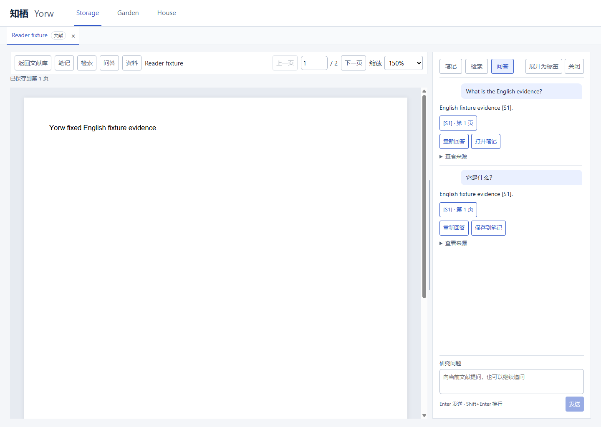
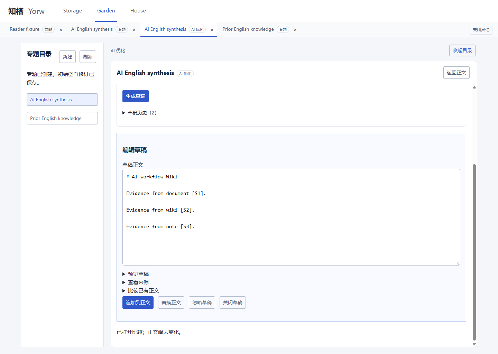
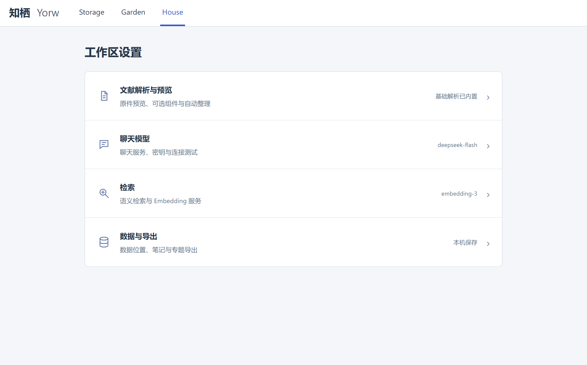

# 知栖 Yorw 作品介绍

作者 osako　版本 v0.2.0　更新日期 2026年10月28日

## 项目概述

知栖 Yorw 的英文全称是 Your own research workplace，是面向科研学习者和个人研究者的 Windows 本地优先阅读与知识工作区。我希望解决的具体问题是：阅读论文时，原文、AI 讨论、个人笔记和专题总结分散在不同工具中，后续整理时难以找回论据，也难以判断某段总结来自论文、个人理解还是模型推断。

项目把这些活动连接为一条可回查的工作流程：导入 PDF，阅读并提问，保存带来源的笔记，关联专题，生成独立的 Wiki 草稿，由用户核对后追加或替换正文，最后保留修订并导出内容。项目目前实现了这一流程，但尚未通过用户研究证明节时效果，也没有将自动化测试结果解释为模型事实准确率。

本文依据当前代码、项目文档和已读取的历史聊天编写。完整开发对话尚未导出；后续会补充实际提示词、错误修复过程和作者审核记录。正文中的功能描述以 v0.2.0 实现为准。

## 项目详情及使用方式

### Storage 管理文献和阅读过程

Storage 支持批量导入 PDF、重复文件识别、文献目录和本地搜索。每篇文献有独立资料页，可保存标题、作者、年份、标签、人工总结、所属专题及相关文献。原文、笔记、检索和问答通过统一标签或阅读侧栏组织，减少不同任务之间的来回切换。

导入后，先打开 PDF 阅读，再在右侧检索或问答。搜索和问答限定当前文献；回答中的来源入口可以回到对应文献和物理页。用户可以把回答保存为笔记，并自行修正或补充理解。当前总结由用户手工编辑，导入不会自动请求总结模型。

### Garden 组织专题和累积认识

Garden 采用层级专题目录。用户创建专题、关联文献并编辑 Markdown 正文；文献笔记会随关联关系展示，不复制成第二份正文。专题正文、AI 优化、修订历史和关联材料分别使用独立标签。

使用 AI 优化时，默认只查找当前专题及子专题关联的材料；只有用户明确选择全工作区，才扩大范围。生成内容先成为可编辑草稿，用户查看来源并与已有正文比较后，选择追加、替换或忽略。采纳与回退均留下修订；生成操作不能直接覆盖正式正文。

### House 配置服务和导出内容

House 分别配置聊天服务和 embedding 检索服务，并提供连接测试、语义检索开关、数据位置查看和内容导出。没有模型配置时，仍可阅读、编辑、管理文献和导出；问答及 Wiki 生成需要用户提供可用的聊天服务。

密钥由 Electron 主进程通过系统安全存储加密管理。数据默认本地保存；调用云端模型时，任务所需文本会发送给相应服务。内容 ZIP 只包含选定的已保存笔记、Wiki 当前正文和来源清单，不等同完整工作区备份。

### 建议体验步骤

1. 按 README 的十分钟指南启动应用，导入自编写样例或有权使用的文本 PDF。
2. 在 Storage 阅读原文、尝试关键词检索，记录一条笔记。
3. 在 House 配置服务后提问，核对引用对应的原文与物理页。
4. 创建 Garden 专题，关联文献，填写要求并生成草稿。
5. 编辑并采纳草稿，查看修订历史，尝试回退和内容导出。
6. 正常退出并重启，确认已保存内容和工作标签恢复。

## 项目亮点

### 让来源贯穿阅读到整理

Yorw 将文献片段、笔记和 Wiki 修订之间的来源关系保存下来。检索结果展示短原文与页码，草稿使用本轮来源编号；来源改变或失效时，保留旧快照并提示状态。这使用户有条件回查内容，而不是只得到一段无法追踪的回答。来源可追踪不等于模型解释必然正确，最终仍需核对。

### 把材料范围变成明确约束

Storage 围绕当前文献工作，Garden 默认围绕当前专题及子专题工作。后端按实际关联关系建立材料集合，范围为空时提示补充关联，不静默使用全库；生成后范围变化会阻止直接采纳。范围控制既出现在界面，也落实到检索与保存条件中。

### 保留用户对知识内容的决定权

AI 草稿与正式正文分开存储。用户可以编辑、追加、替换或拒绝，保存时检查基础修订与来源状态；回退也创建新修订。这样的设计方便积累个人判断，并减少并发修改和自动覆盖造成的内容丢失。

### 在本地工作区完成连续任务

文献阅读、问答、笔记、资料与专题使用统一标签，阅读工具可在侧栏和独立标签之间切换。SQLite 保存业务内容，本地受管目录保存 PDF；未配置云端服务也能完成基础阅读与整理。项目不要求用户部署数据库服务器或独立向量服务。

## AI 测试技术落地使用情况概述

本项目中的 AI 使用分为开发协作、应用功能和质量验证三个层次。

开发过程中，我使用 Codex 辅助拆解需求、生成代码与测试、分析报错和整理文档；我负责确定产品方向、阶段范围、审查结果与推进节奏。AI 提出的修改需要通过类型检查、自动化回归和人工体验，不能以模型自述代替验收。完整提示词与逐轮修订过程将在导出真实对话后补充，当前不估算 AI 代码占比。

应用内部实际调用模型的环节包括语义向量生成、相关候选筛选、带来源问答和专题 Wiki 草稿生成。AI 辅助用户处理知识材料；项目没有训练或发布自有基础模型，也没有实现自主多 Agent 科研系统。

测试使用 Vitest、pytest、自编写 PDF 和本地模型协议夹具。夹具返回可控的检索与生成内容，用来检查接口、来源传递、取消、中断、持久化、追加及回退等行为。2026年10月27日发布准备记录报告桌面测试 55 项、后端测试 181 项通过，打包完整流程及恢复检查通过。这些是历史工程验证结果，本轮文档编写没有重新运行整套测试，不能据此宣称真实论文问答准确率。

真实服务的跨语言召回、事实一致性、引用是否支持结论，以及独立干净 Windows 安装与恢复仍需进一步验收。后续评估会逐题记录允许材料范围、预期证据页、实际回答、引用支持情况、失败原因与耗时，保留负例。

## 项目关键技术

| 技术 | 在项目中的作用 |
| --- | --- |
| Electron 与 electron-vite | Windows 桌面窗口、构建、受限 IPC 和后端生命周期管理。 |
| React 与 TypeScript 及 CSS | Storage Garden House 页面、工作标签、会话状态与界面交互。 |
| FastAPI 与 Pydantic | 本地 API、输入校验和业务服务组织。 |
| SQLite 与追加式 SQL 迁移 | 正文、元数据、来源、任务、修订及关系的持久化；main 发布版 schema 15，v0.3.0 阶段一开发分支 schema 18。 |
| PDF.js 与 pypdf | PDF 阅读和物理页定位，以及后端逐页文字抽取。 |
| FTS5 与 embedding 及 NumPy | 关键词和语义召回、结果融合与本地向量计算。 |
| Chat Completions 兼容接口 | 候选筛选、流式问答和草稿生成，模型由用户配置。 |
| CodeMirror 与 Markdown | 笔记和专题编辑、预览及内容导出。 |
| Vitest 与 pytest | 前后端行为回归，配合隔离工作区和本地协议夹具。 |
| PyInstaller 与 electron-builder | 冻结 Python 服务并生成 Windows x64 安装器。 |

项目目前不包含 OCR、图像证据理解、云同步、多用户和完整备份恢复。它是科研阅读与整理工具，不能据此宣称具备医学诊断能力。

## 项目图片

以下是2026年10月27日本机候选程序自动化验证截图，使用自编写 PDF 与本地模型协议夹具。它们用于展示真实程序界面和工程流程，不是实际论文实验结果；不包含患者资料或真实密钥。原始截图位于本地发布准备报告，提交材料保存相同字节的副本。

图一　Storage 阅读与问答。原文和对话在同一工作区，来源入口对应物理页。

图二　Garden 草稿编辑。用户检查来源后决定追加、替换或忽略。

图三　House 服务设置。聊天与检索服务分别配置，密钥不回显。

## 发表参赛获奖及独立开发说明

依据作者本次确认，本项目此前未参赛、未获奖，由我个人独立开发完成，无其他共同开发者。这里的独立开发指我独立负责需求、设计、开发组织与结果审核，开发过程中使用了 AI 编程辅助和开源依赖，不表示全部代码均由我手工编写。

项目已有 Git 版本记录及软件分发记录；软件公开分发与论文或正式作品发表不是同一事项。是否存在需要申报的其他正式发表情况，尚待作者按主办方口径确认；本稿不将“未参赛、未获奖”扩大为“从未公开”。本次未重新核验远端发布资产。

## 基于其他项目优化的情况

根据作者确认及当前可核查的开发记录，Yorw 是从个人产品构想和需求出发建立的项目，不是对某个已有完整应用进行二次开发。Electron、React、FastAPI 等为使用的开源组件，应保留其许可证和依赖声明，不作为原创基础框架申报。

v0.2.0 是在我自己的 v0.1.0 MVP 基础上的持续迭代：增加统一工作标签和问答布局，补充文献标签、人工总结、文献关系与专题关系，优化批量导入，并把 AI 材料范围默认收敛到当前专题及子专题。版本迭代记录可以回溯至 Git 和项目历史文档，不等于基于他人项目改造。

## 材料依据与后续补充

当前实现参见[架构](architecture.md)和[使用指南](user-guide.md)，历史验证参见[发布准备记录](history/v0.2.0-release-preparation.md)，意图控制与复现论证参见[技术文档](technical-report.md)。本稿对应源码基线为 `78648a36dab3bfd9da6b1c901fd1f565d046ed55`，正文修订以作者审核为准。

完整对话导出后，需要补齐至少三个核心功能的实际需求、上下文、AI 初稿、失败与修正、测试结果及作者审核记录，并对照现有叙述修订。正式提交前还需确认发表声明、最终源码提交、安装包校验值及截图版本一致。
