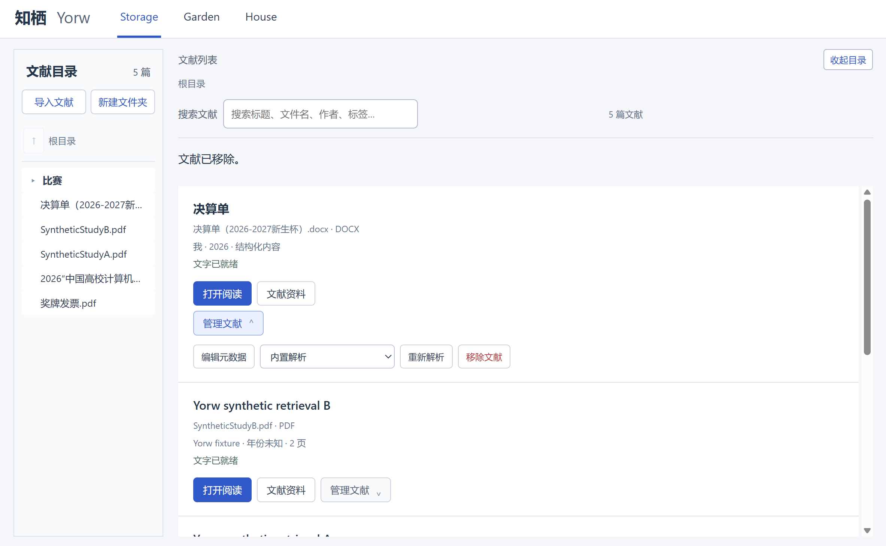
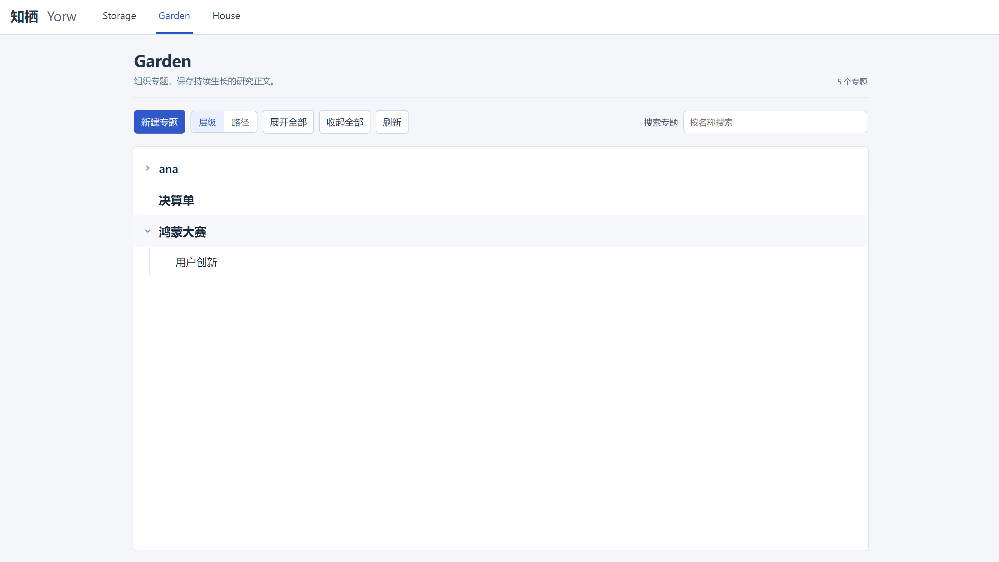
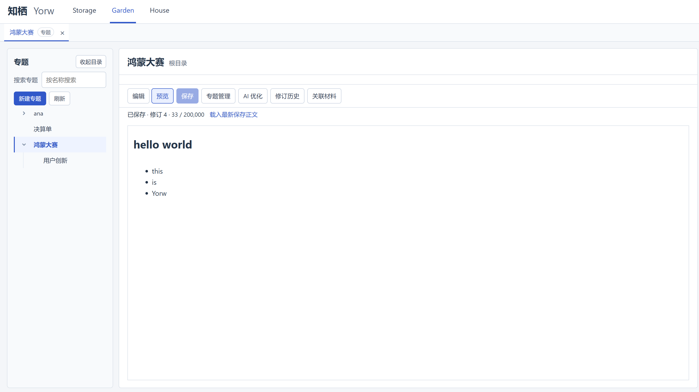

# 知栖 Yorw 作品介绍

知栖 Yorw 是面向科研阅读的 Windows 本地优先知识工作区。我希望将分散的文献、阅读问题、笔记与专题正文连接起来，让阅读中的依据能够被保留，并继续用于后续整理。v0.3.0 已完成本轮功能开发和用户 review；本文用于作品介绍与审核，不代表新安装包已经发布。

整理日期：2026年10月31日。数据库 schema 为23，代码中的应用版本仍为0.2.0，版本标记与发布由后续流程处理。本文对应 `feature/Garden-interface-refine` 工作树；新追加的专题右键与删除等待 review，精确复现需同时保留提交与未提交差异，不能只看版本号。

## 一 项目详情与使用方式

### 从文献到持续更新的研究专题

Yorw 由 Storage、Garden、House 三个空间组成。Storage 管理文献与阅读活动，Garden 组织研究专题和正文，House 集中管理模型、解析与数据设置。用户可以先完成本地阅读、文字检索和手工记录，再按需要启用模型服务。

文献保存在受管理的本地位置。文件夹是应用中的逻辑分类，归类不会移动或改写不可变原件，也不会改变来源标识。目录支持单击展开后代、双击进入文件夹、返回上一级、右键管理和左右拖动调整宽度；未归类文献位于根目录。

图1 文献管理入口。左侧以文件夹和文件展示层级，右侧提供当前目录的搜索与文献操作。截图中的文件名仅用于展示界面，不随作品提交原始材料。

### 阅读原件并核查回答依据

PDF 使用 PDF.js 展示原始页面；DOCX 从原始 OOXML 渲染只读内容；Markdown 和 TXT 从保存的原文件展示。DOCX 基础阅读支持段落、表格和受限图片，不等同于完整 Word 排版。用户也可主动选择 LibreOffice 转换 PDF 预览；旧 DOC 的转换需要自行安装该组件。基础 PDF、DOCX、Markdown、TXT 流程不要求安装 Docling 或外部向量数据库。

阅读页右侧可切换笔记、检索和问答，也可以展开为独立标签。回答使用检索得到的原文片段并附带来源。PDF 来源指向物理页，其他格式使用内容块、章节与可验证定位。不能可靠定位时展示证据片段并说明状态，避免提供无法兑现的跳转。

图2 原文与回答并排核查，来源按钮回到证据位置。截图仅展示交互，不代表模型质量评估。

### 将阅读积累组织为专题

Garden 首页集中展示专题关系，提供层级树、路径列表、名称搜索、全部展开与收起。新建专题打开独立标签；正文页保留侧边目录，名称、父级和其他管理功能通过独立标签处理，让正文编辑区域保持集中。

图3 Garden 首页。缩进与展开状态表达父子关系，路径视图用于直接查看专题所属位置。

用户可把文献关联到专题，编辑 Markdown 正文，并请求 AI 根据所选材料生成草稿。默认材料范围是当前专题及子专题；切换到全工作区需显式选择。草稿生成后仍需用户核查、编辑与采纳，可以追加或替换正文，并查看修订历史及回退。

图4 专题正文与目录。正文支持编辑、预览和保存，专题管理、AI 优化、修订历史与关联材料各有独立入口。

### 配置按需启用的能力

House 使用列表式设置入口，分别打开文献解析与预览、聊天模型、检索、数据与导出标签。聊天和 Embedding 服务分别配置和测试；密钥由 Electron main 使用系统安全存储保护，不交给 renderer 或写入仓库。若使用远程模型，选定文本和请求仍会发送到相应服务商，本地优先不等于所有 AI 计算离线。

图5 设置入口。截图中的模型名是用户配置示例，不是作品捆绑或唯一支持的服务。

首次使用可按 [README 的十分钟复现指南](../README.md#10分钟极速复现指南)准备环境，导入自编写样例、保存笔记、创建专题并重启核查。模型能力另需可用的兼容服务；可选解析组件的配置流程见[使用指南](user-guide.md)。

专题名称支持右键打开、新建子专题、管理和删除。删除单个专题会将其直接子专题提升到父级，保留文献和历史修订，并阻止未保存编辑被丢弃；该追加能力待本轮 review。

## 二 项目亮点

### 以原文为依据连接阅读与知识整理

问答、检索、笔记来源与专题草稿共用来源合同。原始 PDF 页码、非 PDF 内容块和解析版本可以被追踪，过期来源不会被当成当前可靠定位。AI 整理帮助理解和检索，但不替代原文证据。

### AI 建议可管理 正式资料由用户决定

文献资料页保存每次成功的 AI 整理记录，支持历史选择、隐藏和恢复，同时汇集笔记、检索历史与问答历史。元数据页统一维护标题、作者、年份、标签、总结、关联文献和专题。AI 与人工不再形成两套正式标签和总结；AI 提供建议，用户按字段选择替换或追加，版本检查通过后才写入正式元数据。

自动整理默认关闭，开启前明确模型调用与费用；专题推荐需确认，不会自动建立知识关系。生成失败保留既有可用结果，取消或过期任务不能覆盖当前内容。

### 基础能力独立 可选组件可替换

解析通过统一合同和注册表接入。内置处理负责常用格式，Docling 提供用户主动选择的增强解析和可选 OCR，LibreOffice 提供旧 DOC 转换与可选版式预览。组件缺失时在操作处说明依赖，不限制已支持的基础流程。

### 将研究工作留在同一个工作区

文献、工具和专题使用可恢复的标签系统。未保存编辑具有关闭保护，密钥草稿只在内存保留。SQLite 保存正式正文、来源和修订，Markdown 用于内容导出。导出覆盖已保存笔记、专题正文及来源清单，不是包含原件、全部关系和历史的完整备份。

## 三 AI 测试技术的落地使用

开发中，AI 用于拆分需求、生成实现候选、补充测试场景和辅助分析错误。我负责界定任务边界、审核实现与断言、检查界面，并在阶段 review 后决定是否推进。仓库保留计划、迁移、测试和历史记录；尚未导出的完整对话不会被补写成虚构的逐轮证据。

pytest 验证数据库、范围过滤、解析、任务状态、取消竞争、元数据采纳和来源合同；Vitest 与类型检查验证前端状态、目录树、标签和输入输出；Electron 窗口烟测验证实际导入、原件展示、来源跳转、关闭保护、正文采纳、回退、导出和多尺寸布局。冻结后端与完整打包目录另行验证，避免仅在开发解释器中通过。

自编写 PDF、DOCX 等样例和 loopback 模型响应让错误分支可以稳定复现。固定检索对照记录召回、排名、无答案误召回与范围违规，不隐藏失败项。这些测试证明覆盖到的协议和工程行为，不证明真实论文质量、医学可靠性或降低幻觉率。

最近 Garden 视觉细化的历史记录为前端26个文件、74项测试通过，类型检查和构建通过，源码窗口在1024、1280、1440宽度下无横向溢出。此前 Garden 集成记录含后端261项通过及打包窗口回归。最新视觉细化打包因网络超时未完成，不能移用此前打包结果。本次只更新文档，未重跑上述业务测试，详见[工作区开发记录](history/v0.3.0-workspace.md)。

## 四 关键技术与设计取舍

| 层次 | 采用技术 | 作用 |
| --- | --- | --- |
| 桌面与界面 | Electron、React、TypeScript、CSS | 原生窗口、受限 IPC、标签工作区与目录 |
| 本地服务 | Python 3.12、FastAPI、Pydantic | 业务接口、校验、有限并发任务与模型适配 |
| 权威数据 | SQLite、追加迁移、事务 | 原件记录、正文、来源、关系和修订 |
| 阅读与解析 | PDF.js、pypdf、内置 DOCX/MD/TXT | 分离原件阅读与 RAG 内容块，按需外部增强 |
| 混合检索 | FTS5/BM25、NumPy、RRF | 融合文字和语义候选，限定范围并回到原文 |
| 知识编辑 | CodeMirror、react-markdown、remark-gfm | Markdown 编辑、受控预览与人工采纳 |
| 工程验证 | pytest、Vitest、PyInstaller、electron-builder | 协议回归、冻结后端和 Windows 分发验证 |

当前向量存储以 SQLite 和 NumPy 适配实现，没有引入 Chroma、FAISS 或大型 Agent 框架。元数据辅助检索默认关闭；模型筛选候选也不能保证答案正确。项目优先保证可运行、可解释和可追踪，再根据实际失败样例扩展。

## 五 开发归属与既有项目说明

本项目由我独立负责产品构思、需求组织、开发决策、集成、测试审核和文档整理，开发过程中使用 AI 编程助手及开源依赖。“独立开发”不表示全部代码手工逐行编写，也不表示第三方库由我原创。

截至本次材料整理，依据我的声明，项目此前未参赛或获奖。Yorw 不是在他人完整产品上改造而成；v0.3.0 是在本人 v0.1.0、v0.2.0 基础上的连续迭代，主要新增多格式阅读与解析适配、AI 记录和正式元数据采纳、检索增强及文献与专题工作区优化。最终提交前由我复核这一声明与材料使用权限。
