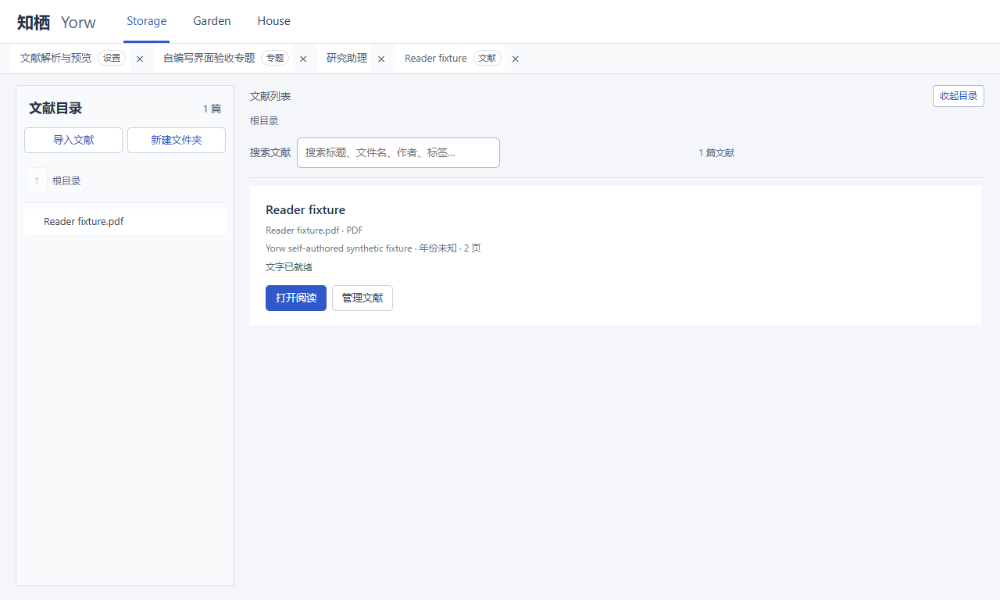
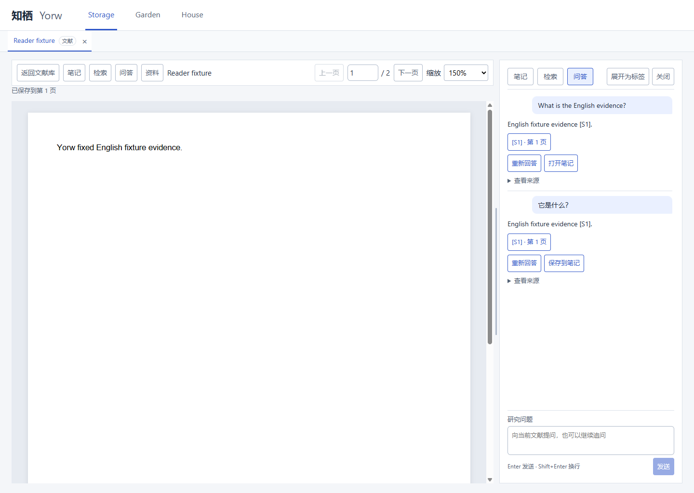
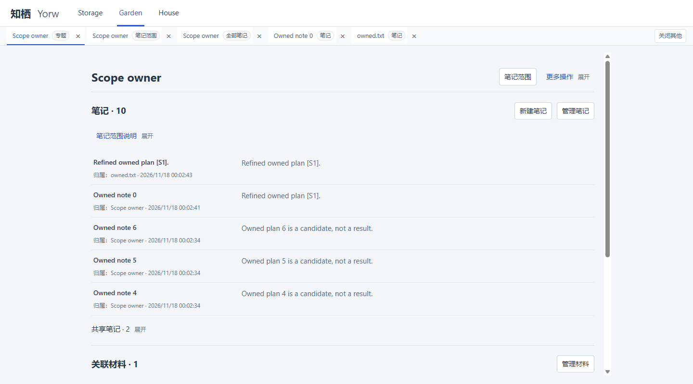
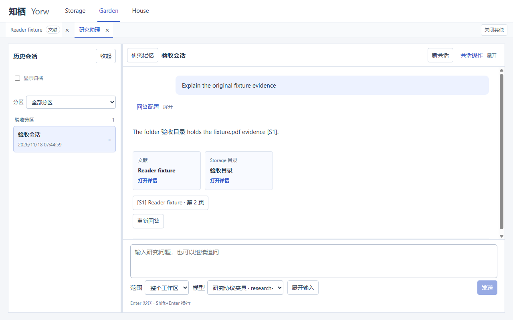
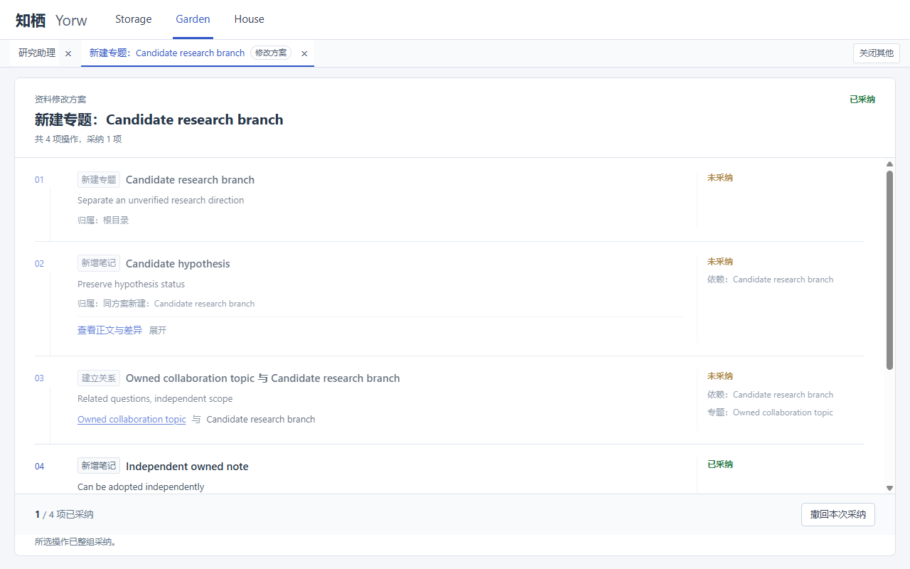
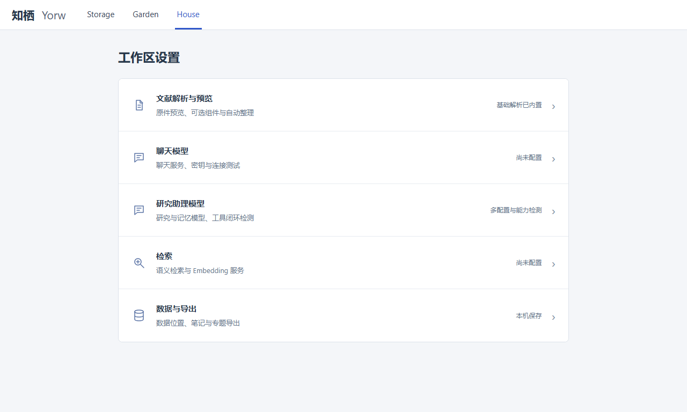

# 知栖 Yorw 作品介绍

> **Your own research workplace.** Windows 本地优先的个人科研文献阅读与知识内化工作区（当前版本 `v0.4.0` / 数据库 `schema 31`）。将多格式文献阅读、可核查原文引用的问答、阅读笔记、研究记忆与层级专题 Wiki 融合在同一桌面闭环中，让 AI 承担材料查找、线索串联与结构化提案，把正式知识的每一次采纳与修订决定权留给研究者本人。

| 项目维度 | 核心信息与工程基线 |
| --- | --- |
| **作品名称与定位** | 知栖 Yorw（Windows 本地优先科研阅读与轻量 RAG 知识工作区） |
| **核心技术栈** | Electron 45 + React 19 + TypeScript 7 \| Python 3.12 + FastAPI + SQLite（WAL / FTS5 / NumPy） |
| **真实演进与代码规模** | `v0.1.0 → v0.4.0` 四轮完整迭代，81 次细粒度 Git 提交，001–031 顺序 SQL 迁移，13 份完整 AI 协同会话归档 |
| **自动化验证基线** | 后端 `pytest` **439 项通过**（含源码与冻结服务 HTTP，0 跳过）、桌面 `Vitest` **106 项通过**、多尺寸原生窗口烟测通过 |
| **首次参赛与原创声明** | **此前未获奖，本次是该作品第一次参赛**；**本项目完全由我从 0 开始独立开发**（非基于其他项目改造） |
| **代码仓库与材料导览** | 仓库：`https://github.com/Osak0/Yorw`；极速复现见 `README.md`，深度架构与 Prompt 工程见《技术文档》，对话全记录见外层 `ai-cowork-history/` |

---

## 一、项目详情及使用方式

### 1.1 真实科研痛点与产品解题思路

在日常科研文献研读与综述整理中，学生与科研工作者长期面临**“三端割裂、出处丢失、AI 越权覆写”**三大真实痛点：

1. **工作流割裂导致上下文反复丢失**：研究者往往同时打开 PDF 阅读器看原文、打开通用网页聊天框粘段落提问、再切换到本地 Markdown 软件记笔记与写专题综述，大量精力消耗在跨软件复制搬运上，阅读思考脉络支离破碎。
2. **通用 AI 总结脱离原文依据，难以学术核查**：直接把长文档丢给通用聊天工具得到的摘要往往缺乏精确页码与原文内容块锚点；当文档更新或跨多篇文献综合时，无法快速回到原文核实模型究竟是忠实引述还是主观臆测。
3. **Agent 直接改写知识库极易污染个人思考**：科研笔记包含大量“原文客观事实”“个人阶段性假设”与“待验证实验想法”。一旦允许 AI 智能体直接覆写本地文件，一次推理偏差就会冲掉研究者宝贵的原始判断。

针对上述痛点，**知栖 Yorw** 构建了统一的产品文化与三空间桌面闭环——**Storage（积累材料）**、**Garden（培育知识）**、**House（安放工作区）**。系统以本地 SQLite 数据库作为正文、来源快照、不可变修订与协作方案的唯一权威存储：未配置任何云端 API 密钥时，多格式导入、原件阅读、笔记编辑与本地文字检索即可 100% 离线运行；接入用户自选的云端或本地兼容模型后，仅按显式选定范围发送相关文本片段，全程遵循**“原文证据可回跳、研究记忆可纠正、正式写入必经人工预览采纳”**的受控闭环。

### 1.2 端到端四步使用方式

**第一步：进入 House 完成服务配置与能力检测（可选但推荐）**

首次启动进入顶部导航的 **House** 工作区设置中心：
- **模型配置与双项能力检测**：分别配置“聊天模型”（用于单篇问答、元数据整理与草稿优化）、“检索”（默认开启语义检索，可随时一键关闭退回纯本地关键词检索）以及“研究助理模型”（支持保存多份供应商配置并分别指定研究默认模型与后台记忆摘要模型）。保存密钥后，点击**“聊天检测”**验证连通性，点击**“工具能力检测”**通过内置自编写探针自动执行“检索 → 读取 → 带编号引用”三轮工具闭环验证（检测过程绝不读取或外发用户真实论文）。所有 API 密钥均由 Electron 主进程调用 Windows 系统级加密接口保护，不暴露给前端界面。
- **解析组件与本地数据管理**：PDF、DOCX、Markdown、TXT 的基础解析与原件预览已全部内置，开箱即用；若需处理旧版 `.doc`、Word 精确版式 PDF 预览或扫描件 OCR，可在“文献解析与预览”中按需选择本机独立安装的 LibreOffice 或 Docling 可执行文件并完成显式授权检测。在“数据与导出”中可查看本地工作区路径，或将已保存笔记与专题导出为含独立来源清单的 Markdown ZIP 快照包（注：内容导出用于成果归档与分享，不含全部原始 PDF 副本，升级前建议备份工作区目录）。

**第二步：进入 Storage 导入多格式文献、组织目录并开展单篇精读**

切换到 **Storage** 空间管理个人文献库：
- **多格式导入与类文件系统逻辑目录**：点击左侧目录栏唯一的“导入文献”入口，支持批量导入 PDF、DOCX、DOC、Markdown、TXT（自动计算 SHA256 去重并保存受管副本，单个异常文件报错不中断整批导入）。左侧目录支持新建多级文件夹、**单击展开层级结构、双击进入目标目录、“上一级”回退、右键唤起紧凑分组菜单**以及左右拖拽分隔条宽度，中右侧提供当前目录实时本地过滤搜索。
- **多模式原件阅读与工作标签切换**：点击“打开阅读”在新工作标签中打开文献。PDF 阅读器支持**连续滚动/单页切换、适合宽度自适应、目录大纲（Outline）、缩略图懒加载导航与 Esc 专注阅读模式**，并自动记忆最后阅读物理页码；DOCX 提供内置安全的只读原件结构预览。右侧面板提供**笔记、检索、问答、编辑元数据**四大工具，既可贴合在阅读器侧栏对照阅读，也可点击“展开为标签”进入独立宽屏工作页，两侧共享同一份实时会话与编辑草稿。
- **混合检索、带来源连续问答与 AI 文献整理**：在“检索”中输入问题即可获得融合关键词与语义重排的前 5 条短摘录（每条严格限制展示长度并附“查看依据”一键跳回原文页高亮）；在“问答”中支持多轮连续追问（后台自动维护增量压缩的 `History.md` 辅助理解指代，并重新检索原文证据），点击回答下方的 `[S1] · 第 X 页` 按钮即可精准滚动至对应段落高亮；点击文献卡片“管理文献”可维护统一元数据（标题、作者、年份、标签、总结、相关文献与所属专题），或在独立“AI 辅助文献整理”标签中对模型提取的字段执行逐栏添加、替换或一键原子采纳。

**第三步：进入 Garden 组织层级专题、管理多笔记范围并与研究助理深度研讨**

切换到 **Garden** 空间沉淀跨文献知识体系：
- **层级/路径双视图与专题多笔记概览**：Garden 首页支持以“层级树”（按父子深度区分字号字重）或“单行路径列表”浏览全部专题，支持右键菜单管理与安全删除（子专题自动提升、存在自有笔记时强制显式选择迁移或删除）。进入专题概览页可集中管理该专题下的**多份自有专题笔记**、关联文献携带的**共享阅读笔记**以及双向专题关联；通过“笔记范围”可按最近显式祖先继承规则精细勾选哪些子专题材料纳入当前研究视野（普通横向关联不会静默扩散 AI 读取范围）。
- **受限工具循环研究助理与会话分区**：打开“研究助理”标签，底部提供 3～8 行自适应多行输入框（支持展开长文输入），可自由切换**“整个工作区”或“指定专题子树”材料范围**。左侧历史栏支持创建文件夹式**会话分区**（单击展开、双击进入、右键重命名/移动/归档/删除；分区仅用于整理会话，绝不扩大授权材料范围）。提问后，助理自动浏览范围内的 Storage 文件夹、Garden 专题树、文献与笔记，先调用 `read_document` 定位正文块句柄，再经 `read_local` 核验原文并生成带 `[S]` 引用的回答；回答完成后，正文下方自动生成经服务端校验的**可点击资料导航卡片**，点击即可直接定位 Storage 文件夹或打开对应文献、专题与笔记详情，彻底告别在聊天框里复制内部 ID 找文件的繁琐操作。
- **可审阅、可纠正的研究记忆**：点击会话顶部的“研究记忆”，可编写全局或专题级“研究指引”，查看自动记录的研究活动轨迹，并对不再适用的旧假设执行**内联纠正或遗忘排除**；系统严格区分客观论文证据与历史讨论背景，杜绝旧推断自我循环成“事实”。

**第四步：审阅结构化修改方案（Proposal），勾选部分采纳或受保护撤回**

当要求研究助理“根据某文件夹下的文献新建专题并整理综述笔记”或“从文献整理页建立新专题关联”时：
- **先预览、后采纳**：研究助理不会直接改写任何正式数据，而是通过 `propose_changes` 生成一张内嵌修改方案摘要卡。点击“查看方案”打开独立方案详情页，逐项核查操作类型（新建专题、新增笔记、追加/重写指定笔记、建立/解除关联）、归属路径、正文对比差异、推荐理由与原文来源。
- **依赖联动部分采纳与防覆盖撤回**：方案自动识别操作间的前置依赖（例如某条新增笔记依赖同方案新建的候选专题 `$key`，取消勾选前置专题会自动联动取消子项，而独立笔记仍可单独采纳；模型额外推荐项默认不勾选）。点击采纳时，服务端在单个数据库写事务内统一核验对象存活、范围快照与乐观版本号；采纳后若发现不满意可点击“撤回本次采纳”，但若此后用户已手工补写过该笔记或在其下新增了内容，系统会自动拦截撤回，严防旧回滚冲掉最新人工心血。

---

## 二、项目亮点

对照真实科研需求与 AI 原生软件工程标准，本项目具备以下五项核心亮点：

1. **全链路可回查的“句柄式原文证据锚定”机制**：
   无论是单篇检索问答、元数据提取，还是跨文献研究助理研讨，所有事实性陈述均绑定稳定对象 ID、活动解析版本号、物理页码/内容块定位与原文切片。研究助理必须先通过目录/正文浏览获取服务端本轮签发的有效片段句柄（Handle），实际读取原文后才能获得 `[S]` 引用编号；一旦底层文献被删除或重新解析导致块失效，历史来源自动动态标记为“来源不可用”，从根源上防止无出处总结与过期引文误导。
2. **创新的“提案式人机知识协作（Proposal-Driven Cowork）”范式**：
   突破常见本地知识库“要么只聊不写、要么 Agent 黑盒直写覆盖”的两难困境，将全部知识库写操作抽象为带 DAG 前置依赖推导（`$prior_key`）的结构化提案预览。支持用户期望项与模型额外推荐项区分勾选、子集原子采纳、幂等防重提交、并发版本冲突拒绝以及人工后续编辑后的防覆盖撤回保护，真正把大模型的不确定输出转化为安全可审计的知识资产。
3. **连续积累、用户可纠正且绝不越权的研究记忆体系**：
   围绕长期科研课题构建了“用户显式研究指引 + 自动活动账本 + 空闲低扰动后台摘要”的研究记忆层。用户每次纠正或遗忘操作都会推进内容版本（`content_version`）并立即阻断正在使用旧背景的在途任务，而后台自动摘要仅推进摘要版本（`summary_version`）且严格限制每日额度与冷却间隔，绝不抢占前台交互；同时在系统提示与数据结构上双重锁定“研究记忆仅为历史讨论线索，不得作为论文结论证据”。
4. **克制优雅的学术桌面视觉与全流程 AI 状态/思考可视化**
   - **紧凑耐看的学术视觉语言**：全站统一采用冷灰背景（`#F4F6F9`）、纯白内容面（`#FFFFFF`）、深灰正文（`#26364A`）与学术深蓝主操作（`#3158C9`）；无工作标签时自动隐藏标签栏，低频管理入口按需收纳，全面通过 1024×768、1280×720、1440×900 多窗口尺寸及 125% / 150% 高 DPI 缩放布局验证。
   - **透明友好的流式反馈与工具思考可视化**：彻底屏除“分块数、2048 维向量、余弦阈值、内部 UUID”等生硬底层术语。单篇问答与草稿生成实时呈现中文阶段进度（`正在理解问题…` → `正在查找原文…` → `正在筛选相关内容…` → `正在生成…`）；研究助理在 SSE 流式输出正文的同时，通过 700ms 增量事件流实时展示工具思考轨迹（如`已查看工作区结构`、`已查看目录`、`已浏览文献正文`、`已读取相关片段`、`工具调用未成功：…模型可修正后重试`、`已生成方案预览`），支持随时一键停止并完整保留已生成阶段内容。
   - **高精细度桌面交互细节**：回答末尾自动渲染可点击资料导航卡片；阅读器与工具标签共享会话草稿、未保存脏草稿关闭弹窗保护、中文输入法（IME Composition）组合选词防误发、阅读定位后用户主动滚走绝不异步强制拉回、重启精准恢复标签顺序与阅读页码且绝不自动重发付费请求。
5. **零外部重依赖开箱即用与零污染可插拔解析扩展**：
   基础安装包与源码环境内建 PDF、DOCX 原生 OOXML 安全树预览、Markdown 与 TXT 处理，不预装数 GB 的深度学习 OCR 运行时即可轻量流畅使用；进阶用户又可通过统一 `yorw_api.parsing` 契约挂载外部独立环境的 Docling（增强解析与 OCR）和 LibreOffice（旧 DOC 与版式预览），重解析失败自动保留上一可用活动版本，兼顾轻量分发与专业扩展。

---

## 三、AI 测试技术落地使用情况概述

本项目不仅在应用内深度落地了轻量 RAG 与受限研究 Agent，在工程研发全周期中也系统落地了 **AI 协同演进控制与五层自动化测试闭环**。

### 3.1 真实透明的四阶段协同演进链路与极速复现支持

项目从零起步历经四轮清晰迭代（共 **81 次细粒度 Git 提交、22 个阶段分支 PR 合并、31 个顺序 SQL 迁移文件**），外层 `ai-cowork-history/` 完整保存了 Codex 与 Claude Code 原始会话及 13 份去噪纯对话提取稿，模块清晰生长、绝非代码拼凑：

| 演进阶段 | 核心工程里程碑 | AI 协同方式与关键真实纠偏闭环 |
| --- | --- | --- |
| **`v0.1.0` MVP 基线** | 跑通 Electron + FastAPI + SQLite 进程安全握手、PDF 阅读抽取、混合检索、带引用问答、Garden 修订与 NSIS 打包 | 按 14 个独立步骤分支推进，每步人工 Review 后合并；实测发现中英跨语种检索余弦分偏低及阈值误杀关键词结果，引导 AI 修正双路回退契约 |
| **`v0.2.0` 统一工作流与多标签** | 重构后台异步一键检索/问答/草稿工作流，解决长草稿截断，建成侧栏与多标签页同源状态宿主 | 针对草稿 `OUTPUT_TRUNCATED` 失败，引导 AI 定位 2048 token 上限与非 `stop` 错误码混同根因，引入 8192 预算、`length` 自动续写与可编辑恢复 |
| **`v0.3.0` 多格式解析与元数据** | 建立 `yorw_api.parsing` 统一解析注册表与内置 DOCX 安全预览、逻辑文件夹目录、结构化元数据 AI 整理与原子采纳 | 强制外部 Docling 独立于项目 `.venv` 安装并适配 2.x `convert` CLI；将正式元数据与 AI 整理历史解耦，演进至 `enrichment-metadata-v6/v7` |
| **`v0.4.0` 研究助理与提案协作** | 多模型工具检测、只读研究工具与同源 `ToolRegistry`、研究记忆、多笔记范围继承、结构化修改方案部分采纳与撤回 | 完成 Stage 1–6 后通过实机体验驱动 R1–R6 整改：解决目录结构不可见、流式完成前抢跑弹出无关导航卡片、长会话 Token 超限压缩及会话分区管理 |

同时，仓库 `README.md` 提供了完整的**《10分钟极速复现指南》**（含环境配置说明、精确依赖清单、`.env.example` 模板、从零生成 MVP 的结构化核心提示词与纠偏提示词、6 项验收清单），评委既可在空目录 10 分钟体验从 0 构建 MVP，也可一键锁定复跑完整 v0.4.0 源码。

### 3.2 AI 辅助测试设计方法与五层自动化验证落地

在测试工程落地上，我采用**“人类定义业务不变量与体验反例 → AI 枚举异常状态分支并生成自动化测试候选 → 人工逐条审查断言并执行红绿回归”**的闭环策略。每当实机使用暴露边界缺陷（例如：工具生成方案后模型流意外中断是否仍保留可采纳方案、用户手工补写笔记后点击旧方案撤回是否会误删人工内容、关闭助理标签重开是否会重复扣费请求），均严禁仅靠修改一句提示词“祈祷模型变聪明”，而是要求 AI 先编写触发该缺陷的失败测试，再补齐服务端状态机守卫与前端时序保护。

在 2026 年 11 月 18 日 `v0.4.0` 发布准备全量回归中，五层验证体系实测结果如下：

1. **后端单元、事务与故障注入测试 + 双态 HTTP 闭环测试（`pytest`）**：共 **439 项全部通过（0 跳过，耗时 315.17s）**，同时覆盖源码服务与 PyInstaller 冻结后的 `yorw-api.exe` 真实子进程 HTTP 调用，全面验证 001→031 备份迁移升级、范围隔离、工具两级参数纠错、单事务部分采纳失败回滚、幂等重试及跨重启恢复。
2. **桌面端主进程、状态机与组件逻辑测试（`Vitest`）**：33 个测试文件共 **106 项全部通过**，覆盖布局 JSON 严格校验、多标签去重与脏草稿关闭保护、会话分区聚合、方案依赖勾选联动与回复导航卡片渲染。
3. **全栈静态类型与锁一致性门禁**：TypeScript `tsc --noEmit` 零错误通过，前后端生产构建与 `uv lock --check --offline` 离线锁校验通过。
4. **Electron 原生窗口与打包制品隔离烟测**：基于本地候选程序 `Yorw-Setup-0.4.0-x64.exe` 解包目录，在隔离工作区与受限 `PATH` 下通过原生窗口自动化探针（`desktop-smoke`、`ui-smoke`、`collaboration-smoke`、`collaboration-resume`），实测验证了 1024 / 1280 / 1440 分辨率与 125% / 150% 缩放比布局、渲染进程零 Node 暴露、部分采纳、撤回冲突拦截、成果卡片跳转、重启恢复及零意外外部请求（`externalRequests = 0`）。
5. **沙箱环境异常排查保真**：测试初期在受限沙箱环境曾触发符号链接 `EPERM` 与子进程启动超时，研发过程严格区分运行环境权限限制与代码缺陷，在标准用户进程权限下完整复跑全绿通过，**全程未删改或放宽任何一条测试断言**。

### 3.3 应用内真实大模型测试与诚实能力边界

工程测试使用临时数据库、自编写合成文档夹具（`make-mvp-fixtures.py` / `make-format-fixtures.py`）和本地 Loopback SSE 确定性模型夹具，用于精确验证工程协议与事务一致性，不冒充真实大模型语义质量。应用内真实云端模型实测单独记录：已完成真实 **DeepSeek** API 的普通聊天探测、三轮本地工具闭环检测，以及包含两份 PDF 与两份 DOCX 的“目录浏览 → 原文读取 → 方案生成 → 部分采纳 → 后续追问”真实业务小样本闭环验证（实测中模型一次传参成功，未触发参数报错分支，故如实记为未触发真实纠错而非宣称该分支已经真实模型验证）。目前 Kimi、GLM、Qwen 等多厂商账号泛化实测、大规模代表性学术论文逐题评测以及独立无开发环境干净 Windows 物理机安装卸载验收尚未完成；本文如实呈现工程与测试成绩，不推导未经测量的事实准确率或幻觉降低百分比。

---

## 四、项目中涉及的关键技术

### 4.1 四层进程安全解耦桌面架构

为确保 AI 辅助生成的全栈代码模块边界清晰、易维护且符合桌面安全规范，系统采用严格的四层单向职责架构：

```text
React Renderer（纯 UI 与交互状态，开启 sandbox + contextIsolation，禁 Node / 禁密钥 / 禁任意路径）
      │
      ▼  类型化白名单桥接（apps/desktop/src/preload & shared 手写同步 DTO 契约）
Electron Main（原生文件选择、safeStorage 系统密钥加解密、外部程序指纹授权、布局校验、Python 子进程托管）
      │
      ▼  127.0.0.1 动态回环端口 + stdin 注入随机 Bearer 会话令牌 + /health 握手与退出回收
Python 3.12 + FastAPI 单进程后端（按 parsing / retrieval / research / research_memory / notebooks / collaboration 解耦）
      │
      ▼  RLock 串行化短写事务 + WAL 并发读 + 001–031 顺序追加迁移（升级前 SQLite Backup API 自动备份）
本地受管工作区（yorw.sqlite3 唯一业务权威库 + SHA256 受管原件副本 + 派生缓存与单向 Markdown 导出）
```

### 4.2 轻量混合检索引擎与可插拔多格式解析合同

- **本地混合检索与原文精筛（`EvidenceRetriever`）**：基于活动版本 `document_blocks` 进行带重叠边界切块（上限 800 字符、重叠 100 字符）；结合中文问句虚词过滤的 **SQLite FTS5 / BM25 词法召回**（Top 40）与按配置版本缓存的 **NumPy 归一化精确余弦向量召回**（Top 40），经 **RRF（倒数秩融合）** 去重合并后取前 20 项，再由聊天模型仅返回候选块 ID 与相关句下标完成精筛，程序校验下标合法后直接截取原文片段返回，禁止模型篡改引文内容。检索无匹配证据时本地直接拒答，不浪费模型调用也不给幻觉留空间；元数据辅助检索默认关闭，即使开启也强制回落到原文内容块。
- **版本分离的统一解析注册表（`yorw_api.parsing`）**：统一定义结构化 `ParseResult` 与块定位契约，内置 `pypdf`、Markdown、TXT 及原生 OOXML 解析器，外部 Docling 与 LibreOffice 通过独立适配器按需接入。系统将尝试解析版本（`parse_version`）与当前活动版本（`extraction_version`）严格分离：只有新解析完整成功才原子切换活动版本并失效旧向量缓存；中途取消或解析失败自动保留上一可用正文。

### 4.3 同源工具注册表、有界 Agent 循环与单事务提案协作

- **同源工具注册表（`ToolRegistry`）**：通过不可变 `ToolSpec` 将工具名称、功能描述、JSON Schema、参数校验器、执行函数与返回类型同源绑定，彻底消除“发给大模型的工具声明与后端实际校验逻辑不一致”的工程漂移；模型仅能传入受当前会话范围约束的逻辑实体 UUID 或本轮已签发 Handle，不暴露任何文件系统路径或 SQL 接口。
- **两级参数自纠错与渐进式上下文压缩**：工具层严格区分协议流损坏与业务参数错误（`ToolFault`）。当模型传入可修正参数偏差（`correctable=True`）时，系统按对应 `tool_call_id` 返回字段级结构化错误提示，允许最多 **2 次**自纠错；多轮长任务重传前，自动将较早的目录/列表结果压缩为保留计数与关键 ID 的合法 JSON 摘要，并完整保留最近 6 条原文证据结果与更早证据的页码引用编号，兼顾长链路推理连续性与 Token 成本控制。
- **单事务乐观锁协作写入（`Collaboration`）**：方案采纳在同一 SQLite 写事务内原子校验目标专题/文献/笔记版本、目录成员依赖快照、来源可用性与 `request_id` 幂等记录，写入不可变 `revisions` 与决策审计表；任何子项冲突即整组无副作用回滚，彻底杜绝半成品脏数据。

### 4.4 安全漏洞防御与防性能死循环工程保障

针对 AI 应用常见的安全隐患与失控死循环风险，系统内置了多层硬性工程护栏：

- **安全防御闭环**：① 渲染进程严格沙箱隔离，IPC 校验来源窗口、`mainFrame` 与本地 URL；② API Key 经系统级 `safeStorage` 加密存储，更换 API 基地址强制要求重新确认或清除密钥，防密钥误发往第三方端点；③ 内置 DOCX 原生 OOXML 解析严格限制 ZIP 条目数、解压字节上限与 XML 节点深度，禁用 DTD/外部实体、外部关系、SVG 及任意 HTML 注入（防御 Zip Bomb、XXE 与 XSS）；④ 外部解析器路径须经用户原生对话框选择并记录可执行文件指纹，且限制固定参数前缀，防止任意命令执行。
- **防死循环、防重复扣费与防界面卡顿**：① 研究助理循环设定 **单任务最多 10 轮模型调用、24 次工具执行、24 条引用来源、180 秒墙钟超时及输入/输出 Token 硬预算**；重复失败调用立即终止，重复相同参数成功调用回放摘要并达限熔断，彻底杜绝 Agent 死循环；② 前台 AI 任务通过 `foreground.assert_idle` 事务级单飞互斥，服务启动时自动将上次异常退出的遗留 `running` 任务置为 `interrupted`，绝不在重启或恢复标签时自动重发请求；③ 数据库写锁仅包裹毫秒级本地 SQL，全部外部网络流式请求均在写事务外执行；④ PDF 阅读器采用 `IntersectionObserver` 仅绘制可视区附近页面并及时释放离屏 Canvas 内存，保障长文献流畅阅读。

---

## 五、项目相关的图片/照片

以下 6 张实机运行截图完整展示了 **知栖 Yorw（v0.4.0）** 在 Windows 桌面环境下的三大核心空间、原文引用问答、专题多笔记管理、带导航卡片的研究助理以及提案式人机采纳流程（其中图 1、图 3～图 6 采集自 2026 年 11 月 18 日本机 v0.4.0 隔离窗口验证环境，图 2 采集自本机真实中文竞赛通知 PDF 阅读与多页引用问答验证；界面截图用于如实展示产品交互与工程闭环）：



*图 1：Storage 文献库主界面——顶部保留 Storage / Garden / House 蓝白导航与多工作标签栏，左侧提供类文件系统逻辑目录与唯一导入入口，右侧为紧凑文献检索与管理列表。*



*图 2：Storage 阅读与带来源问答界面——左侧 PDF.js 渲染原件并记忆物理阅读页码，右侧问答面板基于检索到的原文证据生成回答，明确标注证据边界并提供 `[S1]`–`[S5]` 物理页码一键回跳与“保存到笔记”入口。*



*图 3：Garden 专题概览界面——统一管理当前专题下的多份自有专题笔记、子专题共享笔记、显式祖先“笔记范围”配置与关联文献材料，顶部多标签支持在专题、范围与单篇笔记详情间流畅切换。*



*图 4：Garden 研究助理界面——左侧支持按文件夹式“分区”结构化管理历史会话，右侧展示带 `[S1]` 页码引用的回答及服务端校验生成的“文献 / Storage 目录 打开详情”可点击导航卡片，底部支持范围选择与自适应多行输入。*



*图 5：资料修改方案（Proposal）独立详情页——清晰列出新建专题、新增笔记、建立关系共 4 项候选操作、前置依赖关系与正文差异入口，支持仅采纳独立子项（1/4 项已采纳）并提供受冲突保护的“撤回本次采纳”能力。*



*图 6：House 工作区设置中心——集中管理内置/可选文献解析与预览、聊天模型、支持多配置与工具闭环检测的研究助理模型、语义检索开关以及本地数据目录与快照导出。*

---

## 六、项目发表与获奖情况说明

**此前未获奖，本次是该作品第一次参赛。**

本作品此前未在任何其他竞赛、学术期刊/会议或商业渠道发表、参评或获奖。作品源码仓库托管于 `https://github.com/Osak0/Yorw`（MIT License），当前处于 `v0.4.0` 本地发布准备阶段，详细集成与发布核验状态记录于仓库根目录 `PLAN.md`。

---

## 七、项目原创性与独立开发说明

**本项目完全由我从 0 开始独立开发**，并非在其他已有开源项目、往届作品或商业成品项目基础上修改或优化。

从最初的科研阅读痛点定义、`Storage / Garden / House` 三空间产品架构与交互规范设计、进程安全边界与 SQLite 001–031 数据契约定义，到开发态上下文分层治理、核心 Prompt 迭代控制、前后端代码集成审查（阶段 Review）、实机体验排障与五层自动化测试验收，均由我本人独立主导完成。开发过程中我合理使用了 AI 编程助手（Codex、Claude Code）辅助生成候选代码与自动化测试，并按标准工程规范引入公开开源基础运行库（Electron、React、FastAPI、pypdf、PDF.js 等，精确版本均由 `pnpm-lock.yaml` 与 `services/api/uv.lock` 锁定声明）；完整的 AI 协同开发原始对话记录与纯对话提取稿均真实保留在提交材料 `ai-cowork-history/` 目录中供评委审阅。
